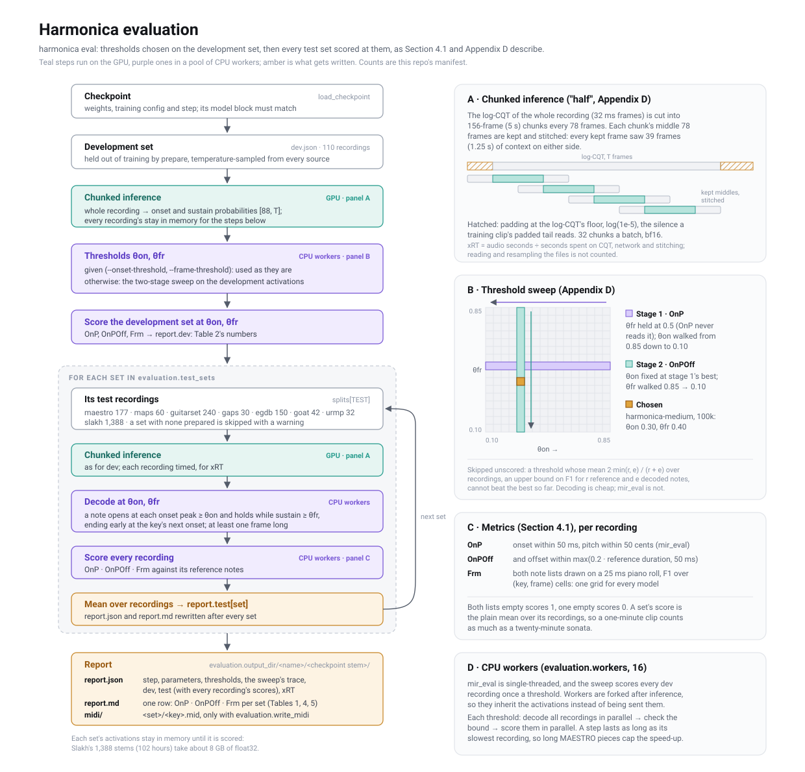

# Harmonica evaluation

`harmonica eval` reproduces the paper's benchmark (Section 4.1,
Appendix D): choose the decoding thresholds on the development set, then score
every test set at them. It writes Table 1's row (and the appendix's Tables 4
and 5, which add OnPOff) and Table 2's development-set numbers.



## Running it

```bash
# The whole benchmark: sweep on dev, then every test set.
harmonica eval --size medium \
    --checkpoint outputs/harmonica-medium/checkpoints/checkpoint_100000.ckpt

# Thresholds already known (from an earlier report): skip the sweep.
harmonica eval --size medium --checkpoint ... \
    --onset-threshold 0.3 --frame-threshold 0.4

# Only some sets, into a directory of its own.
harmonica eval --size medium --checkpoint ... \
    --onset-threshold 0.3 --frame-threshold 0.4 \
    --override 'evaluation.test_sets=[slakh]' --output outputs/evaluations/harmonica-medium/slakh
```

Pass the `--size` (and any `--override`) the run trained with: the checkpoint
stores its own config, and `harmonica eval` refuses one whose model block differs
from the config given.


| Setting                     | Default               | What it does                                                                                   |
| --------------------------- | --------------------- | ---------------------------------------------------------------------------------------------- |
| `evaluation.test_sets`      | all eight sources     | Sets to score, in this order; a set with no prepared test recordings is skipped with a warning |
| `evaluation.workers`        | 16                    | CPU processes decoding and scoring; a count, or `all` (`--workers`)                            |
| `evaluation.devices`        | 1                     | GPUs transcribing at once, one model on each; a count, or `all` (`--devices`)                  |
| `evaluation.batch_size`     | 32                    | Chunks through the network at once                                                             |
| `evaluation.threshold_grid` | 0.10 to 0.85 by 0.05  | The sweep's candidates, for both thresholds                                                    |
| `evaluation.max_recordings` | none                  | Score only the first N recordings of each set (smoke tests)                                    |
| `evaluation.write_midi`     | false                 | Also write every test recording's decoded MIDI                                                 |
| `evaluation.output_dir`     | `outputs/evaluations` | Reports go to `<output_dir>/<name>/<checkpoint stem>/` unless `--output` says otherwise        |


### On every GPU at once

On one machine, `--devices` gives every recording, dev and test, to whichever
GPU is free next, longest first, and writes one report; the sweep and scoring
use the `--workers` processes as before:

```bash
harmonica eval --size medium --checkpoint ... --devices all --workers all
```

Each recording runs on one GPU, so on GPUs of one kind the scores match a
single GPU's bit for bit. xRT adds up each recording's own seconds, but the
threads share the CPU, so it reads lower than a `--devices 1` run's; time
xRT with one GPU.

GPUs of different generations give scores that differ in about the fourth
decimal place: bf16 kernels differ slightly, and a few notes on the edge of a
threshold flip; an A6000 and a Blackwell card do this.

## What it does

1. **Load the checkpoint**: weights, the config it trained under, its step.
2. **Transcribe the development set**: the recordings `prepare` held out of
  training (`dev.json`; 110 recordings, 4.5 h). Their onset and sustain probabilities stay in
   memory.
3. **Choose the thresholds**: given on the command line, or swept on the
  development activations (below).
4. **Score the development set** at those thresholds: `report.dev`, the
  numbers Table 2 reports.
5. **For each test set**: transcribe its recordings, decode them at the
  thresholds, score each recording, and take the mean over recordings. Both
   report files are rewritten after every set, so a run that dies keeps the
   sets it finished.


### Chunked inference

Appendix D's "half" strategy. The CQT, `log10(1 + |X|)`, of the whole
recording (16 kHz, hop 512, 32 ms frames) is cut into 156-frame (5 s) chunks every 78 frames. The
network sees each chunk, and only its middle 78 frames are kept and stitched,
so every kept frame had 39 frames (1.25 s) of context on either side. The half
chunk before the first frame and after the last is padded with zeros,
`log10(1 + 0)`: silence, which is also how a short training clip's padded
tail reads. Chunks go through 32 at a time under bf16 autocast.

xRT is audio seconds divided by the seconds spent on the CQT, the network, and
stitching. Reading and resampling the file is not counted.

### Choosing the thresholds

Two stages over the same grid, each walked from 0.85 down to 0.10:

1. The **onset threshold** that maximises dev OnP. The frame threshold is held
  at 0.5, since OnP never reads it.
2. The **frame threshold** that maximises dev OnPOff, at stage 1's onset
  threshold.

A threshold is skipped, unscored, when even a perfect match could not beat the
best so far: for `r` reference and `e` decoded notes F1 is at most
`2 min(r, e) / (r + e)`, and the mean of that over recordings is cheap to get.
Decoding is fast and mir_eval is not, and a low threshold on a weak model
decodes tens of thousands of notes. Walking from the top lets the sparse,
cheap thresholds set the bar first. The sweep's every step, scored or skipped,
is in `report.json` under `sweep`.

### Decoding

The paper's fixed `g`: a note opens at every onset peak (a local maximum along
time) at or above the onset threshold, and lasts while sustain stays at or
above the frame threshold. It ends early at the key's next onset, and lasts at
least one frame. The offset head is a training target only and plays no part.

### Metrics

Every recording is scored on its own:

- **OnP**: mir_eval's note F1 with offsets ignored. A match needs the onset
within 50 ms and the pitch within 50 cents.
- **OnPOff**: the same, also requiring the offset within
`max(0.2 × reference duration, 50 ms)`.
- **Frm**: both note lists drawn as piano rolls on a 25 ms grid, F1 over
(key, frame) cells. It is read off the decoded notes, not the activations, so
every model is scored on the same grid.

When both lists are empty the score is 1; when only one is, it is 0. A set's
score is the plain mean over its recordings, so a one-minute clip counts as
much as a twenty-minute sonata.

### The report

`<output_dir>/<name>/<checkpoint stem>/`:


| File                   | Holds                                                                                                                                                                                                                                                                                                         |
| ---------------------- | ------------------------------------------------------------------------------------------------------------------------------------------------------------------------------------------------------------------------------------------------------------------------------------------------------------- |
| `report.json`          | `checkpoint`, `step`, `parameters`, `thresholds`, `sweep` (null when thresholds were given), `dev`, `test` (each set's means, the `seconds` and `audio_seconds` behind its xRT, and `recordings`: every recording's three scores, keyed by its manifest key), `xRT`, and `complete` (false while sets remain) |
| `report.md`            | One Markdown row: #Param, xRT, and OnP, OnPOff, Frm for every set scored                                                                                                                                                                                                                                      |
| `midi/<set>/<key>.mid` | Decoded notes, only with `evaluation.write_midi`                                                                                                                                                                                                                                                              |


The per-recording scores let a subset be re-averaged without running anything
again: GOAT's DI recordings alone (keys ending `_di`), say, or one EGDB tone.

## Workers, memory and time

mir_eval is single-threaded, and the sweep scores every development recording
once per threshold. Decoding and scoring therefore run in `evaluation.workers`
processes. They are forked after inference, so they inherit the activations
instead of being sent them. For each threshold, every recording is decoded in
parallel, the bound is checked, and then every recording is scored in
parallel. A step lasts as long as its slowest recording, so the long MAESTRO
pieces in the development set cap the speed-up there. Slakh's 1,388 stems of
similar length parallelise well.

A set's activations stay in memory until it has been scored. Slakh's are the
largest: 102 hours of audio, about 8 GB of float32 probabilities.

Measured for `harmonica-medium` on a shared workstation: inference on the
development set takes about a minute. With one process the sweep took
about an hour, at 1 to 3 minutes per threshold. With 32 workers a threshold
took about 40 s where one process took 74 s.

## Things to know before running it

- **Evaluate against the manifest the run trained with.** `dev.json` and the
test lists come from `prepare`, and re-preparing after any change to the
corpora or the readers redraws the development set. A development
set drawn after training can hold recordings the model trained on. Keep the
cache a run trained with, and copy it whole to any other machine that
evaluates the run.
- **Every source's audio must be readable where the evaluation runs.** The
manifest stores absolute paths, and the development set draws from every
training source.

